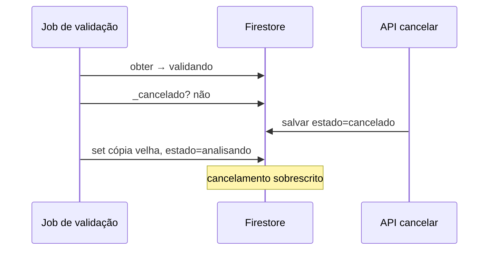
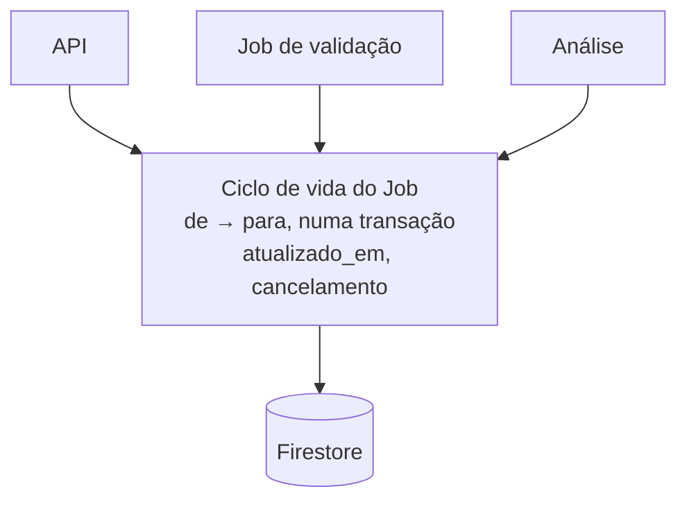
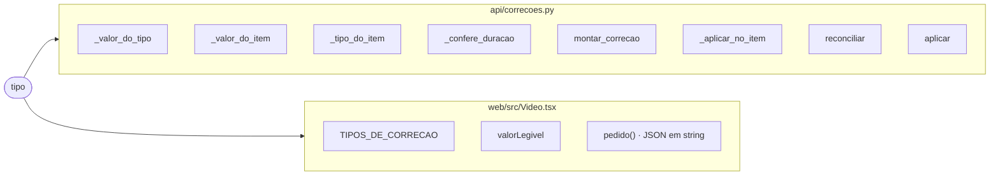
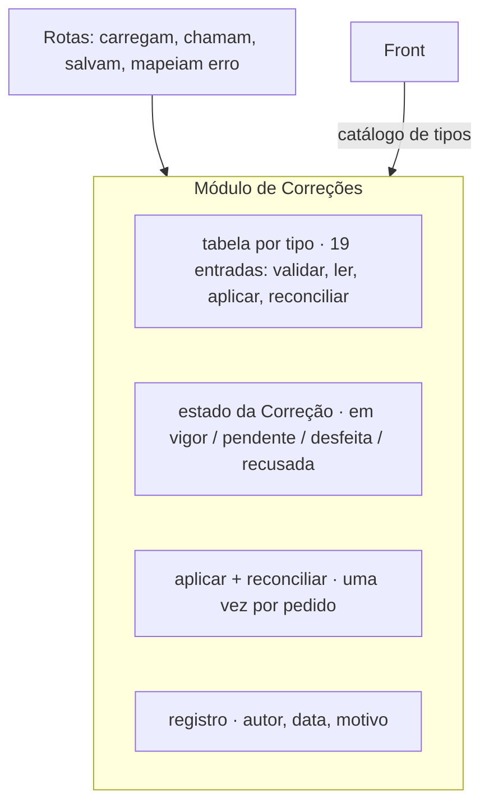
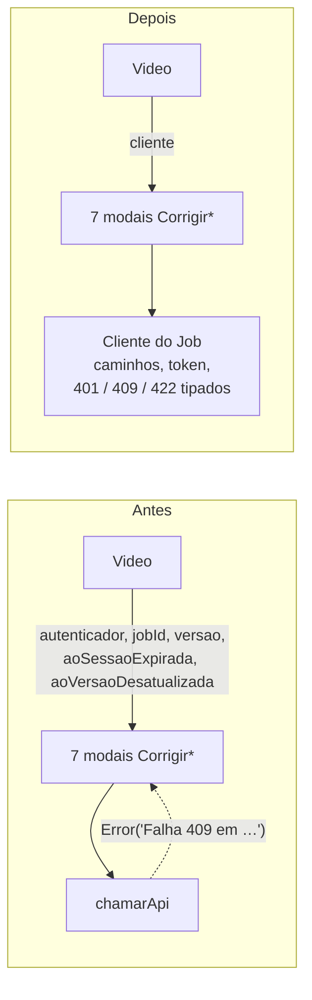
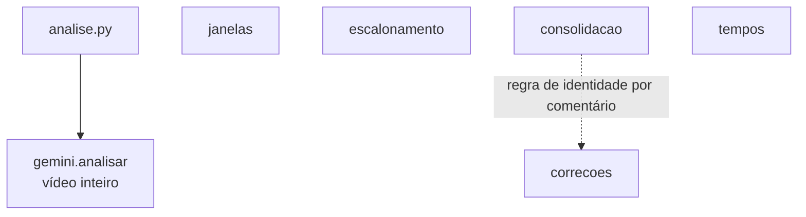

# Revisão de arquitetura — 30/10/2026

Feita sobre a `main` em `d2cf6ba`, olhando primeiro os arquivos que mais mudaram nos commits recentes. Procura módulos rasos, cuja interface é quase do tamanho da implementação, e propõe aprofundá-los: muito comportamento atrás de uma interface pequena, testável por ela.

Vocabulário: **módulo** (qualquer coisa com interface e implementação), **interface** (tudo o que o chamador precisa saber), **profundo / raso**, **seam** (onde a interface mora), **adaptador**, **alavancagem** (o que o chamador ganha), **localidade** (mudança e bugs num lugar só). Termos de domínio vêm do `GLOSSARY.md`. Nenhum candidato contraria os ADRs 0001–0005.

Já profundos, sem mudança: o seam `Transporte` do Gemini (`api/gemini.py`), o `Autenticador` com 3 adaptadores (`web/src/auth/`) e `web/src/envio/upload.ts`. Os testes do `api/` substituem dependências por fakes de Protocol, sem monkeypatch.

## Tickets

| Ordem | Candidato | Ticket |
| --- | --- | --- |
| 1 | Um dono para as transições do Job | #97 |
| 2 | Aprofundar o módulo de Correções | #98 |
| 3 | Cliente da API ligado ao Job, no frontend | #99 |
| 4 | Linha do tempo da Decupagem fora do render | #100 |
| — | Janelas de análise: um orquestrador | acrescentado ao #73 |

## 1 · Um dono para as transições do Job

**Strong** · local-substitutable (emulador do Firestore)

- `api/validacao_job.py:23-71` · `api/analise.py:41-103`
- `api/jobs.py:70-86, 267-288, 444-456`
- `api/nuvem.py:49-50` (`.set()` do documento inteiro), `205`

Antes, o cancelamento se perde:

Depois, uma transição atômica num módulo:

**Problema.** Três processos mudam o estado do Job com `model_copy` + `set()` sobre uma cópia lida antes do trabalho longo. `_atualizar` e `_cancelado` estão copiados em dois arquivos, e checar o cancelamento e salvar não são atômicos.

**Solução.** Um módulo de ciclo de vida do Job que faz cada transição de→para numa transação e é o único a escrever estado, timestamps e falha.

- Corrige a corrida de cancelamento
- Legalidade das transições num lugar
- Localidade: o Job inteiro em um módulo
- Corrida testável pela interface

Junto: `analise.py` grava a Decupagem com um `Bucket` cru e monta `gs://…`, enquanto a leitura passa por `Armazenamento`. Levar a gravação e a URI do proxy para essa porta deixa a análise testável sem emuladores.

Dormente: `expirar_uploads` não tem chamador em produção, e `ArmazenamentoStorage` herda `cancelar_upload` do `ArmazenamentoIndisponivel` (503). A varredura falharia quando fosse ligada.

## 2 · Aprofundar o módulo de Correções

**Strong** · in-process

- `api/correcoes.py`: 1.859 linhas, 102 funções e classes, 62 × `tipo ==`
- `api/jobs.py:475-712`: rotas de `/correcoes` e `/fila`
- `web/src/Video.tsx:260-341, 1769-1781, 2042-2096, 2606-2690`
- `api/tests/test_{correcoes,aprovacao,comerciais,pautas,ocorrencias,planos_e_falas,campos_do_esquema_12}.py`

Antes, um tipo de Correção mora em 11 lugares:

A rota `corrigir` encadeia `_ler_modelo` → `listar` → `valor_atual` (8 argumentos) → `montar_correcao` (11 kwargs) → `acrescentar`. Desfazer, `_resolver` e `_decidir` repetem a mesma forma.

Depois, um lugar por tipo:

**Problema.** Cada um dos 19 tipos de Correção está espalhado em ~8 cadeias de `if tipo ==` no backend e em 3 lugares no frontend. O estado de uma Correção é recalculado com operações de conjunto em 6 funções que precisam concordar.

**Solução.** Concentrar o despacho por tipo, o estado, a aplicação e a montagem do registro atrás de uma interface pequena; as rotas deixam de orquestrar primitivas.

- Localidade: um tipo novo toca um lugar
- A interface encolhe; ~25 funções viram internas
- `aplicar` roda uma vez por pedido (comentário `ponytail:` na linha 1637)
- Sete arquivos de teste, um seam
- IDs `com%03d`/`fal%03d` definidos uma vez

## 3 · Cliente da API ligado ao Job, no frontend

**Strong** · ports & adapters (HTTP; msw nos testes)

- `web/src/api.ts`: 23 linhas, interface do tamanho do fetch
- `web/src/Video.tsx`: 18 × `chamarApi`, 16 × `message.startsWith('Falha …')` (10 de 409, 6 de 422)
- `web/src/Video.tsx:645-740, 1366-1455, 1739-1800, 2000-2120, 2719-2800`

**Problema.** `api.ts` é raso: a interface repete a do fetch, os erros saem como texto e cada chamador classifica 409 e 422 comparando a mensagem. Cada modal recebe 6 ou 7 props só para chegar ao HTTP.

**Solução.** Um cliente criado uma vez por Job, que esconde os caminhos, o token e a tradução dos status HTTP em erros tipados.

- Alavancagem: uma interface, 18 chamadores
- As props dos modais encolhem
- A casca dos 7 modais vira uma só
- Modais testados com um cliente falso

## 4 · Linha do tempo da Decupagem fora do render

**Worth exploring** · in-process

- `web/src/Video.tsx:246-414` (`tempo`, `lerTempo`, `tempoDoCampo`, `faixasDe`, `maiorFim`)
- `web/src/Video.tsx:429-564, 788-835` (alças, faixas, seleção e arrasto)
- `web/src/Biblioteca.tsx:51` (`formatarDuracao` arredonda; `tempo` trunca)
- `web/src/Video.test.tsx:1495-1533`

| Antes: testar o limite de uma alça | Depois |
| --- | --- |
| render `<Video>` + msw + `AutenticadorFalso` | chamada direta ao módulo |
| abrir a aba, selecionar o plano | assert sobre o retorno |
| 31 + 91 + 61 × `fireEvent.keyDown` | |
| `spyOn(getBoundingClientRect)` | |
| ler o texto no DOM | |

**Problema.** Nenhuma dessas funções é exportada: o único jeito de testá-las é renderizar o Video inteiro, e o formato de tempo existe duas vezes, com arredondamentos diferentes.

**Solução.** Um módulo puro que recebe a Decupagem e a seleção e devolve faixas e posições, testado sem DOM.

- Testes sem 183 eventos de teclado
- Localidade: o formato de tempo num lugar só
- O `Video.tsx` (3.354 linhas) encolhe

## 5 · Janelas de análise: um orquestrador, não seis peças soltas

**Speculative** · in-process, atrás do seam `Transporte`

- `api/janelas.py` · `api/escalonamento.py` · `api/consolidacao.py` · `api/tempos.py` · `api/pessoas.py`
- `api/analise.py:78` (uma chamada sobre o vídeo inteiro)
- `api/correcoes.py:676, 764` (identidade "como na consolidação", por comentário)

**Problema.** Janelas, Escalonamento e consolidação têm testes próprios e nenhum chamador em produção. O laço que vai juntá-los, onde os bugs vão aparecer, ainda não existe.

**Solução.** Quando as janelas forem ligadas (#73), escrever um módulo profundo que seja dono do laço inteiro, com as peças atuais como internas, em vez de colar as peças uma a uma.

O plano (`docs/Plano_MAM.md:271-272`) põe a distribuição das janelas em paralelo no Workflows. O módulo pode ficar com o planejamento e a consolidação e deixar o paralelismo ao Workflows; essa divisão é decisão do #73.

## Recomendação principal

**Aprofundar o módulo de Correções.** É onde o código mais muda e onde cada mudança custa mais: cada tipo de Correção acrescentado nas últimas semanas tocou ~8 lugares no backend e 3 no frontend, e o próximo tipo vai pagar o mesmo preço.
